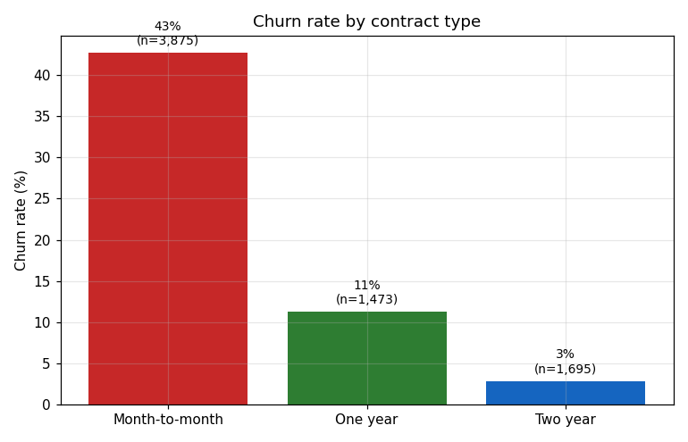
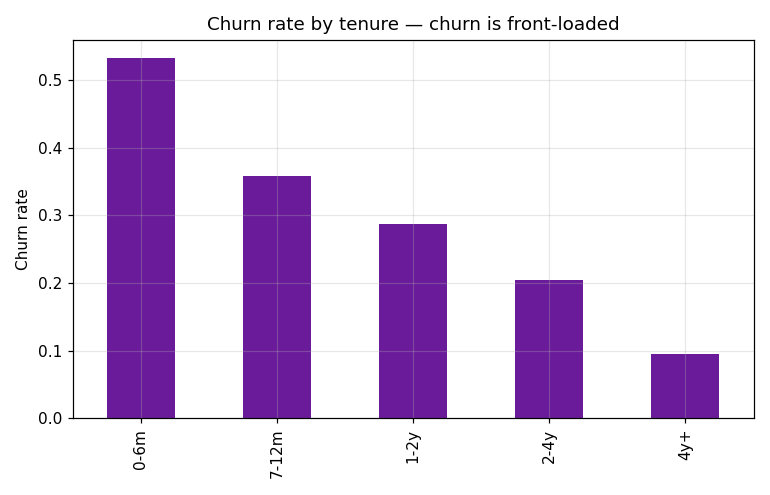
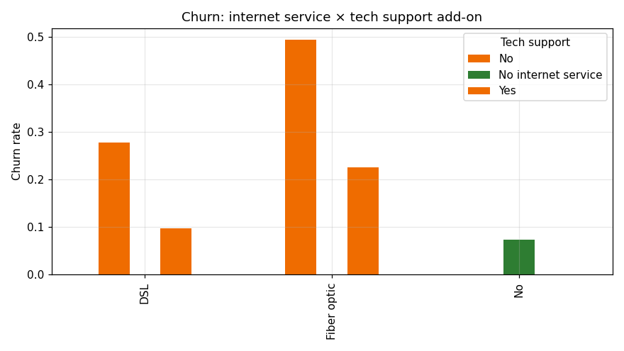
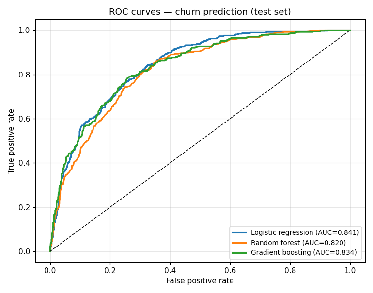
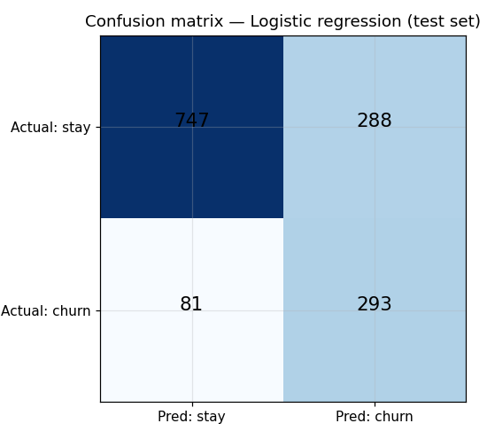
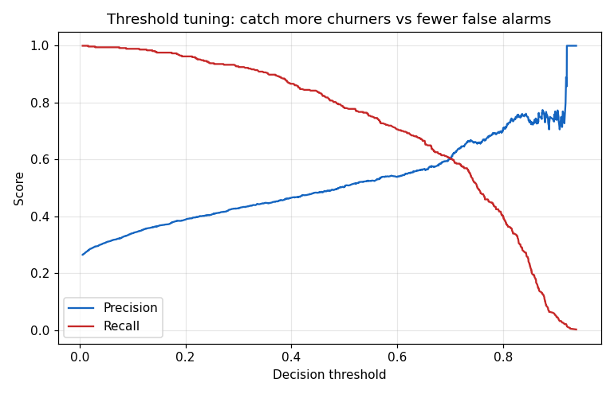
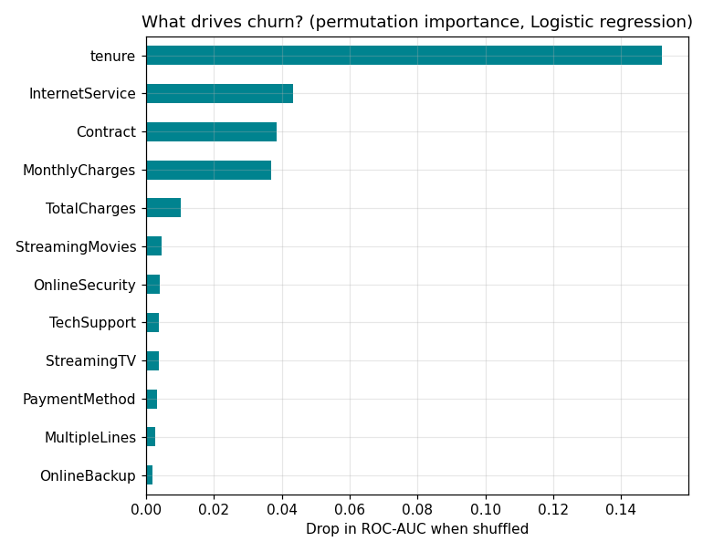

# Telecom Customer Churn Prediction (Supervised ML · scikit-learn)

**Business problem:** which customers are about to leave — so the retention
team can intervene *before* they churn, not after. The classic supervised-ML
use case in telecom, built end to end.

**Data: IBM Telco Customer Churn sample dataset — 7,043 real customers,
21 columns** (demographics, services, contract, billing). Overall churn rate:
26.5%.

## Method

1. **Clean:** blank `TotalCharges` coerced → median-imputed (11 rows).
2. **EDA:** churn by contract, tenure band, and service/add-on segments.
3. **Split:** stratified 80/20 train/test (test churn 26.5%, matches base).
4. **Models:** logistic regression vs random forest vs gradient boosting —
   all with `class_weight="balanced"` for the 26.5/73.5 imbalance, tuned via
   5-fold stratified CV on ROC-AUC.
5. **Threshold:** tuned on the precision/recall tradeoff for the retention
   use case (catching churners matters more than false alarms).

## Results (test set, n=1,409)

| Model | Accuracy | Precision | Recall | F1 | ROC-AUC |
|---|---|---|---|---|---|
| **Logistic regression** | 0.738 | 0.504 | **0.783** | 0.614 | **0.841** |
| Gradient boosting | 0.759 | 0.532 | 0.746 | 0.621 | 0.834 |
| Random forest | 0.762 | 0.544 | 0.628 | 0.583 | 0.820 |

Logistic regression wins on ROC-AUC (0.841) and recall — the two metrics
that matter when the cost of missing a churner exceeds the cost of a false
alarm. Simpler model winning is itself a finding worth reporting.

## Business readout

- **High-risk segment (p ≥ 0.7): 1,783 customers, 25.3% of the base** —
  churning at **62.6% vs 26.5%** overall. Monthly revenue at risk: **143,464
  in monthly charges** (dataset's native units).
- **Their profile:** month-to-month contract + fiber optic + no tech support.
- **Top churn drivers** (permutation importance): tenure first by far, then
  internet service, contract type, and monthly charges.
- **Recommendation:** target contract-upgrade + tech-support add-on offers at
  this exact segment in the first 6 months — churn is heavily front-loaded
  (see chart 02).









## Honest notes

- Sample/demonstration dataset (IBM's public sample), not a live operator's
  data — the methodology is the transferable part.
- Charges are in the dataset's native currency; revenue-at-risk is
  illustrative.
- Class imbalance handled with balanced weights; no SMOTE — kept the
  pipeline auditable.

## Run it

```bash
python3 churn.py            # full pipeline: clean -> EDA -> models -> charts
python3 build_notebook.py   # rebuilds notebook.ipynb with embedded charts
```

## Files

- `churn.py` — the full pipeline
- `build_notebook.py` — assembles the readable notebook
- `notebook.ipynb` — narrative + code + embedded charts
- `telco_churn.csv` — the dataset (as downloaded)
- `model_metrics.csv` — per-model test metrics
- `feature_importance.csv` — permutation importance ranking
- `charts/` — seven output charts (PNG)
